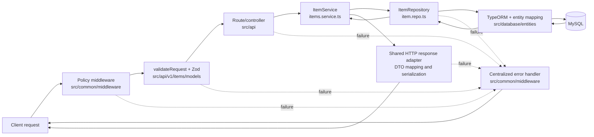

# Architecture

[Documentation index](../README.md#documentation)

## Architecture and execution paths

### Source layout

```text
src/
├── index.ts                         process entry point
├── api/
│   ├── app/                         root and operational endpoints
│   └── v1/items/                    item routes, controller, application service, request models, and OpenAPI definitions
├── application.ts                   lifecycle service graph
├── config/                          environment, HTTP, database, logging, metrics, docs, routes
├── common/
│   ├── exceptions/                  typed HTTP errors
│   ├── handlers/                    startup and shutdown lifecycle
│   ├── helpers/                     shared helpers
│   ├── library/                     shared response/query models
│   ├── middleware/                  request policy, telemetry, validation, and error middleware
│   ├── routes/                      final not-found handler
│   └── store/                       request context storage
└── database/
    ├── entities/
    ├── migrations/
    └── repositories/

test/
├── unit/
├── integration/
├── e2e/
└── helpers/database/                disposable-MySQL orchestration and safety guard
```

There is one HTTP process and one TypeORM `DataSource`; this is not a generated multi-service or
multi-version application. Routes currently comprise the application/operational routes and the
`/api/v1/items` resource.

### Startup path

1. Importing configuration loads `.env` through `dotenv/config`, validates the complete environment,
   and stops immediately on invalid or missing values.
2. `src/index.ts` registers the service graph with the lifecycle handler.
3. Startup initializes MySQL/TypeORM, verifies committed migration history, and then awaits the HTTP listening event.
   A database failure prevents the port from opening; a bind failure rejects startup.
   Concurrent startup calls share the pending operation.
4. If a later service fails, already initialized services are stopped in reverse order. A bootstrap
   failure is logged and shutdown sets a failing process exit code.

Startup deliberately does **not** synchronize the schema or run migrations
(`synchronize: false`, `migrationsRun: false`). Migrations are a separate operator/deployment step.
Unapplied migrations reject startup before the listener opens. Runtime database
readiness uses a shared, bounded `SELECT 1` probe through the application pool.
See the [database lifecycle](architecture.md#database-lifecycle) for acquisition ownership,
timeouts, caching, recovery, and shutdown sequencing.

### Request path

Shutdown admission runs before all routes, including static files. Express then serves the
favicon/static files. Application traffic passes through metrics,
request-context and HTTP logging, security headers and rate limiting, header sanitization/limits,
request timeouts, content-type and method policies, CORS, and the body-size/parser middleware. It is
then dispatched to application routes, `/api/v1`, or the documentation routes (`/docs`,
`/docs-json`, and `/redoc`). Disabled diagnostics/metrics groups are rejected
before their handlers execute, and documentation is mounted only when enabled.
See [operational exposure](configuration.md#operational-endpoint-exposure) for
environment defaults and the external access-control boundary. Unknown routes
become a typed 404.

Controllers validate inputs with Zod models and delegate item operations to `ItemService`.
The service owns lookup/not-found handling, PATCH/PUT semantics, and mutation sequencing;
the repository owns TypeORM persistence. Controllers configure DTO mapping and status
through the shared `jsonHandler`/`textHandler` HTTP adapters. Those adapters check
response availability before mapping/serialization, so controllers never repeat
`canRespond` checks or handle Express response state themselves.
Item controllers pass bound service methods directly:

```ts
router.get(
  '/:id',
  validateRequest({ params: IdParams }),
  jsonHandler(itemService.get, toItemDTO),
);
```

`jsonHandler` passes the parsed `{ params, query, body }` values to the service.
Unvalidated locations remain `null`; routes without validation receive all three
locations as `null`. Services declare only the locations they need, receive no
Express request or response, and use arrow methods so direct references retain
their repository binding. The adapter checks response availability before DTO
mapping and serialization.

Item mutation controllers opt into response preparation inside the transaction:

```ts
jsonHandler(itemService.update, toItemDTO, { transaction: true });
```

The handler opens one outer transaction, calls the service, maps/validates the DTO,
resolves its HTTP status, and prepares the JSON string before the final deadline
check and commit. It sends those prepared bytes only after commit succeeds. JSON
preparation uses plain `JSON.stringify()` once. Transactional responses do not
apply optional Express replacer, spacing, or HTML-character escaping settings. Invalid output, serialization failure, invalid status,
or a propagated business/persistence failure rolls back the entire transaction.

Service transaction wrappers remain in place. They join the outer transaction
through the shared helper, or open their own transaction for standalone calls:

```ts
public update = ({ params, body }: { params: IdRouteParams; body: UpdateItemInput }): Promise<ItemEntity> =>
  this.repo.transaction(async (manager) => {
    const { expected_version, ...changes } = body;
    const item = this.requireVersion(
      await this.repo.get_by_id_for_update(params.id, manager),
      expected_version,
    );
    return this.repo.update(item, changes, expected_version, manager);
  });
```

Every lookup and write in the workflow must receive that manager to use the same
connection and transaction. Create wraps its insert; update/replace/delete wrap
both lookup and mutation. Get/list remain ordinary reads.

Multiple service/repository wrappers on the same data source reuse the same manager
and have one outer commit. They must propagate failures and use the supplied
manager for every participating operation. Independently committed transactions,
other databases, and external side effects are outside that boundary. The wrapper
does not itself add domain concurrency or idempotency guarantees. Item mutations
explicitly lock their target row, compare the expected revision, and include the
revision in UPDATE/DELETE conditions. This supplies stale-write protection while
retaining the transaction/response lifecycle boundary. Optional keyed item mutations add
shared MySQL lock/claim/replay coordination through `jsonHandler`; its outer
transaction includes the item and exact prepared response record. The controller
supplies operation/scope metadata; business services remain unaware of keys and
request lifecycles. See [idempotency](architecture.md#request-idempotency-implementation) for scope and failure behavior.
A lifecycle-owned hourly cleanup service starts after MySQL, quiesces on shutdown,
and drains after HTTP but before database teardown.

Only item creation, PATCH/PUT, and the POST deletion action opt in; reads and system endpoints retain
their ordinary adapters. Do not enable handler transactions for streaming or
unbounded work. Response preparation holds database connections/locks until it
finishes. Successful preparation and commit cannot guarantee network delivery.

System controllers use the same direct-method pattern. `SystemService` collects
the root, health, readiness, information, diagnostics, and metrics results;
controllers retain DTO mapping, readiness HTTP status, and metrics content type.
Health does not probe the database, while readiness still checks lifecycle
dependencies on each request.

Expected `HttpError` values, malformed JSON, and Zod failures are mapped to JSON error responses.
Unexpected failures are logged with request context and returned as a generic 500 so internal error
details are not disclosed. The error envelope contains `status`, `message`, and `timestamp`.

Reusable price and revision schemas live in `src/common/library/models/price.model.ts`
and `version.model.ts`. Item contracts compose `PriceSchema`, `VersionSchema`, and
`VersionInputSchema` from that common library.

Item price payloads, output DTOs, and filters share `PriceSchema`: bounded
positive two-decimal numbers/plain decimal strings with no implicit rounding or
boolean/collection coercion. List queries use a unique ID tie-breaker in the same
sort direction and reject unsafe page offsets before repository dispatch. These
contracts preserve the existing decimal storage and offset pagination API; they
do not create a stable multi-request snapshot under concurrent writes.

### Design Decisions

The application keeps its boundaries explicit: `src/api/` owns transport and routing; item Zod
contracts live in `src/api/v1/items/models/` and are applied by `validateRequest`; and
`src/common/middleware/` owns cross-cutting HTTP policy and centralized error handling. Persistence
is exposed through `src/database/repositories/item.repo.ts`, while `src/database/entities/` owns the
TypeORM database mapping. Startup, shutdown, and runtime wiring remain outside the request features
in `src/application.ts`, `src/common/handlers/lifecycle.handler.ts`, and `src/config/`.



Controllers connect validated HTTP input to service operations and configure response DTO mapping.
Services orchestrate repository calls. The repository/transport separation prevents TypeORM and MySQL details from leaking
into routing code, and prevents HTTP status, envelope, and response-mapping mechanics from becoming
coupled to persistence. Lifecycle and configuration code compose these layers without assigning
request or storage responsibilities to the process bootstrap.

### `createApp` middleware ordering

The registration order in `createApp` (`src/config/http-server.config.ts`) is part of the HTTP
server's behavior, not a cosmetic grouping of middleware. Express enters middleware in registration
order and unwinds wrappers after downstream processing completes, so preserve these constraints:

1. **Static assets intentionally bypass API telemetry and policies.** After shutdown admission, the explicit favicon handler
   and public-directory middleware run first so asset requests do not consume API rate-limit budget,
   produce API metrics or logs, acquire request context, or encounter API content-type and method
   rules. Moving either static handler below those layers would change both observability data and
   the policy surface for assets; moving arbitrary application routes above the policy stack would,
   conversely, create an unprotected bypass.
2. **Telemetry wraps downstream processing.** Metrics, request context, and HTTP logging are entered
   before policies and routes so they can observe outcomes and latency from everything downstream,
   including policy rejections, controller responses, 404s, and errors. Moving them after a rejecting
   policy would make those rejected requests invisible, while putting request-context creation after
   logging could deprive logs and error reporting of correlation data.

   Metrics and HTTP logging subscribe to one request-outcome observer. It takes a
   single timing/outcome snapshot on finish or disconnect and removes its own
   request/response listeners before notifying subscribers. Aborted responses go
   to a separate counter rather than completed-response metrics. Full declared
   route templates keep series bounded and distinguish router mounts. See
   [logging and metrics](deployment.md#logging-and-metrics) for fields, labels, and observation boundaries.

3. **Proxy trust precedes identity capture and IP-based rate limiting.** `trust proxy` is configured
   from validated `TRUST_PROXY` addresses/CIDRs immediately after app creation, before request-context
   and logging middleware. It defaults to false. It must be set before the limiter is
   registered and handles requests because the limiter keys on `req.ip`. Reversing that dependency
   can group clients under the proxy address or derive identities from the wrong hop, weakening or
   misapplying throttling. The configured trust boundary must not be broadened casually either,
   because trusting unvalidated forwarding data can allow clients to spoof the identity used by the
   limiter. Sanitization retains Express forwarding headers only from a trusted transport peer;
   untrusted forwarding metadata is stripped. CORS preflight headers and configured allowed
   request headers survive sanitization, subject to blocked-header and proxy-trust rules.
4. **Cheap request policies reject before expensive request work.** Security headers, rate limiting,
   header sanitization and limits, timeouts, content-type enforcement, the method allowlist, and CORS
   all run before body parsing and controllers. Moving parsing or route dispatch ahead of them would
   spend CPU and memory on requests that should have been rejected and could let a route escape a
   security, abuse-prevention, protocol, or cross-origin control. Their relative order also has
   observable consequences: for example, moving the limiter before proxy trust changes its key, and
   moving timeout setup after parsing leaves body consumption outside that timeout protection.
5. **Body limits and parsing precede dispatch.** `bodyLimitMiddleware` selects and advertises the
   applicable size limit, then parses JSON before any supported route runs. Dispatching first would
   let controllers receive an unparsed body or consume payloads without the centralized limit;
   parsing before the limit would allocate work before oversized input is rejected.
6. **The not-found handler follows every supported route.** Application, versioned API, and
   documentation routes must all have a chance to match before `not_found` converts the request to a
   typed 404. Moving it upward would shadow every route registered below it.
7. **The error handler remains last.** `errorHandler` must follow routes and `not_found` so failures
   passed from any downstream policy, parser, controller, or fallback are mapped to the same safe
   response envelope. Middleware or routes placed after it would not have their failures mapped
   consistently and could leak Express's default error behavior instead.

### Shutdown path

The lifecycle handler installs one-shot `SIGINT` and `SIGTERM` handlers and fatal handlers for
uncaught exceptions and unhandled rejections. Shutdown immediately makes readiness false, closes
initialized services in reverse startup order (HTTP listener first, then TypeORM), waits for the
listener to drain, and preserves a nonzero exit code for fatal or cleanup failures. Repeated shutdown
requests share the pending cleanup. HTTP drain is bounded separately from the overall
shutdown watchdog; see [deadline settings](configuration.md#http-deadlines-and-shutdown-configuration).
HTTP readiness checks the actual listening state. Shutdown quiesces services
synchronously before awaiting pending startup or reverse cleanup, so late startup
cannot restore readiness or admit new work.

JSON/text controllers use shared response adapters backed by `trackHandler` to
retain promises beyond response completion or disconnect. Lifecycle owns a
`RequestContext` per admitted request and carries it through asynchronous work
using `AsyncLocalStorage`. The timeout middleware sets its absolute deadline;
timeout/disconnect marks it abandoned. Services receive no lifecycle object and
contain no deadline checks. The adapter skips late DTO mapping and response writes.

`runInTransaction` checks the ambient request before acquisition, after acquisition,
and after the entire callback settles, immediately before TypeORM commits. Expiry
or a business error rejects the callback so TypeORM rolls back and releases the
connection. Running SQL is never interrupted or released early. Nested application
transactions reuse the active manager from the same data source; unmanaged active
transactions are rejected. Non-HTTP callers have no HTTP deadline and still receive
normal transaction commit/rollback behavior. Expected request abandonment is not
logged as a late application failure; genuine late failures remain observed/logged.
A disconnect/expiry racing the final check or an already-started COMMIT can still
leave a committed mutation without a successful response. External side effects
are not undone by database rollback; keep them outside this guarantee.
Already accepted work remains tracked through transaction cleanup.
New routes must await their work; detached tasks are outside the drain contract.
Use the lower-level `trackHandler` only for custom transport handling, such as
streaming, where the handler must own its response semantics. A response deadline
does not cancel an already-running database operation. Database cleanup begins
after handler work settles, or after a failed finite HTTP drain. A failed drain
keeps exit status nonzero and retains the overall watchdog for live stuck work.
The production smoke check exercises real container SIGTERM; focused process and
MySQL tests exercise accepted work and deadline failures.

## Documentation ownership

Keep the [README](../README.md) short and link to one authoritative guide per topic:
[Setup](setup.md) for installation/local commands, [Configuration](configuration.md)
for validated settings, the API contracts section below for client behavior,
[Testing](testing.md) for checks/isolation, [Security](security.md) for trust/access
boundaries, [Deployment](deployment.md) for operations, and [Backlog](backlog.md)
for unresolved work. Keep detailed contracts in the relevant sections of these seven guides.

Describe supported behavior in the present tense. Keep dated execution records
separate from procedures and label them with source/release identity. Do not turn
reference guides into implementation diaries or duplicate transient test counts.
When moving guides or changing headings, update inbound links, local anchors,
and command examples against the actual scripts and validation code.

## API contracts

### Items

The resource is `/api/v1/items`. There is currently no authentication or authorization middleware. Request bodies use JSON.

| Method and route                | Behavior                                                                    |
| ------------------------------- | --------------------------------------------------------------------------- |
| `POST /api/v1/items`            | Validate a create payload and return the created item with 201              |
| `GET /api/v1/items`             | Return paginated items with `data`, `total`, `page`, and `limit`            |
| `GET /api/v1/items/:id`         | Return one item or 404                                                      |
| `PATCH /api/v1/items/:id`       | Update supplied fields using required `expected_version`                    |
| `PUT /api/v1/items/:id`         | Replace using required `expected_version`; omitted description becomes null |
| `POST /api/v1/items/:id/delete` | Delete using required `expected_version`; return the removed DTO with 200   |

The [item schemas](../src/api/v1/items/models) define field validation and response mapping. The [controllers](../src/api/v1/items/controllers/items.controller.ts) validate request locations before calling the [item service](../src/api/v1/items/services/items.service.ts), which coordinates repository operations. Shared HTTP adapters own response mapping and serialization. PUT and PATCH require an existing identifier; neither creates a missing item. Optimistic concurrency is required for item updates/deletion. All four item mutation routes support optional durable idempotency.

Optional `Idempotency-Key` on POST creation, PATCH, PUT and the POST deletion action provides [24-hour atomic replay](architecture.md#request-idempotency-implementation).
Send one opaque case-sensitive key of 1–128 printable ASCII characters without
whitespace or commas. Matching validated input replays the original successful
status/JSON; changed input or an in-flight key returns 409. Invalid/duplicate keys
return 400, invalid input returns 422, and unsuccessful attempts are not cached.
The scope is public: callers sharing a key share replay/conflict behavior. Keys
are not authorization. Replay does not extend expiry or reflect later edits/deletion.
Expired keys may execute again; retention is not indefinite duplicate protection.
Reads/system routes ignore this header. Without a key, the mutation executes without a replay record.
For update/delete retries, keep the original `expected_version`: completed replay
skips current-version/existence checks. A new attempt still enforces them. Changing
the ID, version or validated payload under the same operation/key returns 409.
Browser preflight requires `idempotency-key` in custom CORS allowed headers; defaults
include it. Scheduled cleanup removes only expired completed replay records.

### Item revisions and mutation preconditions

Every item response, including list entries, includes numeric `version`. Creation
starts at 1. Send the version from the last read as `expected_version` in the JSON
body of PUT, PATCH, or `POST /api/v1/items/:id/delete`:

```json
{ "price": 29, "expected_version": 1 }
```

```http
POST /api/v1/items/A1b2C3d4E5f6G7h8/delete
Content-Type: application/json

{ "expected_version": 2 }
```

- Versions/preconditions are integers from 1 through 4294967295. JSON strings,
  fractions, booleans, null, and missing values are invalid and return 422.
- PATCH must supply at least one editable field in addition to the precondition.
  PUT requires name and price; omission of description still clears it to null.
- Every accepted PUT/PATCH advances the revision exactly once, including updates
  whose submitted values equal stored values. Clients must retain the returned
  revision for the next mutation. Overflow returns 409 without changing data.
- A valid request for a missing/deleted item returns 404. An existing item with a
  stale precondition returns 409 without mutation. Reload before reconciling a
  stale edit; do not silently replace its precondition and overwrite newer data.
- Deletion returns the removed item with its last persisted version; it does not
  increment a revision on a row that no longer exists. A later deletion returns 404.
- Lookup, SQL revision condition, write, response preparation, and final commit
  share the mutation transaction. A rollback also restores the previous revision.

Deletion uses the POST action with a JSON body; `DELETE /items/:id` returns 404.
PUT/PATCH requests without `expected_version` return 422. Preconditions use the
JSON version field rather than ETag/If-Match. Versions prevent stale writes, not duplicate creation or uncertain
commit outcomes. Use a retained idempotency key and original payload for mutation retries within the replay window.

### Price precision and input

Prices use the existing MySQL `DECIMAL(10,2)` column and range from **0.01 through
99999999.99**. API inputs accept JSON numbers and unsigned plain decimal strings
such as `12`, `12.5`, and `"12.50"`. They must have at most two decimal places;
excess precision is rejected with 422 before persistence, never silently rounded.
The shared price contract also validates returned values and decimal filters.
Responses remain JSON numbers, so trailing zeros are not formatting guarantees.

Strings must contain digits with an optional decimal point and one or two following
digits. Blank/whitespace strings, surrounding whitespace, exponent/hex strings,
leading plus signs, booleans, arrays, objects, and null are rejected. `"1.230"` is
rejected for excess textual precision. JSON numbers are checked by their parsed
numeric value; JSON parsing does not retain their original spelling or trailing
zeros. No binary multiplication/modulo equality check or rounding is used to
accept values. Rejected create/update inputs leave rows and revisions unchanged.

### Pagination and filters

`page` defaults to 1; `limit` defaults to 25 and accepts positive integers up to 100.
The page must be a positive safe integer, and `(page - 1) * limit` must also be a
safe integer. Unsafe pages/offsets return 422; there is no additional arbitrary page
cap. These are arithmetic safety limits, not a guarantee that deep pagination is
cheap.

`search` matches item name or description. `sort` accepts `name`, `price`, or
`createdAt`; the default is `price`. `order` accepts `ASC` or `DESC`
case-insensitively and defaults to ascending. ID is always the unique secondary
sort in the same direction: default ordering is `price ASC, id ASC`.

Optional `min_price` and `max_price` are inclusive bounds using the same positive,
two-decimal price contract. Omit unused bounds; empty, malformed, repeated, or
crossed bounds return 422. The minimum cannot exceed the maximum.

This makes adjacent pages deterministic when the underlying data is unchanged.
Offset pagination is not a shared snapshot across requests: concurrent insertion,
deletion, or changes to sort values can shift rows and cause repeats/skips. The
item revision contract does not freeze list results. Cursor/snapshot pagination
is outside the current pagination contract.

Price/query validation follows the current schema. Clients must follow the documented input types and decimal precision;
broad type coercion and excess-precision values are not accepted.

### Response deadlines

The API response deadline defaults to 10 seconds, including body parsing. Expiry
returns the JSON error envelope with status 408 if no headers were sent; otherwise
the incomplete response is closed. Late controller responses are suppressed.
Server receive deadlines can return a raw 408 before Express handles the request.

Item mutations run in an explicit transaction that also covers response DTO
validation, status selection, and JSON preparation. Those failures roll back the
mutation; a success response is sent only after commit succeeds. Request expiry/disconnect observed
before the shared pre-commit check causes rollback after outstanding work settles.
It does not cancel running SQL. Expiry/disconnect racing the final check or an
already-started COMMIT cannot guarantee rollback; a lost response can mean the
write succeeded. Only opted-in keyed item mutations have replay protection; reconcile other
uncertain mutation outcomes before retrying.
New requests reaching the shutdown admission guard receive 503 with connection
closure; once the listener closes, connections are refused instead.

### Errors and HTTP policies

Operational routes follow validated [exposure settings](configuration.md#operational-endpoint-exposure).
Documentation, metrics, and runtime diagnostics default to disabled in production
and enabled in development/test. Disabled routes return 404. Enabling a route does
not authenticate callers; restrict metrics and diagnostics at the ingress and
block direct public access to the API listener.

The rolling-window limiter returns 429 for an exhausted client quota and 503 when
an unseen client cannot be tracked because the store is full. Both include an
integer `Retry-After` in seconds and the standard JSON error body. See
[rate limiting](security.md#rate-limiting) for defaults, capacity policy, and retry timing.

`/ready` uses bounded database connectivity checks and returns
`{ ready, status, timestamp }` with 200 or 503. Dependency names and timings
are internal and are not part of the public response. `/health` does not query MySQL.
See [database readiness and recovery](architecture.md#database-lifecycle) for caching, outage
timing, migration checks, and connection cleanup. Business writes are not retried
automatically after a database disconnection.

Errors use `{ status, message, timestamp }`. Request schema validation returns 422; malformed JSON returns 400; missing items return 404. Unexpected failures return a generic 500 while internal details are logged. Body limits, content-type restrictions, header policies, and rate limiting apply before routes; see [middleware ordering](architecture.md#createapp-middleware-ordering).

Swagger at `/docs`, JSON at `/docs-json`, and ReDoc at `/redoc` expose the generated schemas. CORS defaults to `http://localhost:3000` and is configurable through the validated [HTTP policy settings](configuration.md#proxy-and-cors-configuration). See [backlog](backlog.md) for remaining runtime gaps.

## Database lifecycle

One TypeORM data source and bounded mysql2 pool serve the API, readiness, and
migration CLI. The adapter owns a FIFO acquisition queue; queue and connection
budgets do not cancel leased business SQL. Late/expired acquisitions cannot start
work. Startup checks committed migration history before listening, without
synchronization or automatic migrations. History equality does not prove arbitrary
schema/data correctness.

Readiness shares one in-flight `SELECT 1` acquisition/query and briefly caches
healthy and failed results. Its deadline begins before acquisition. Failed/stalled
probe connections are retired; other request connections and the pool survive.
If a lease arrives after the probe expires, it is released without starting SQL.
Further probes share the failed result while that acquisition is still owned.
The lifecycle handler also caps dependency-response waiting at five seconds;
a larger configured probe deadline does not remove ownership of pending work.

Polling discovers outages and recovery on the same pool; runtime probes do not
rerun migration inspection. A cached success may briefly outlive connectivity.
Readiness does not guard item routes: direct and accepted requests can still
encounter database errors. Liveness remains dependency-independent after startup.
At initial startup both probes are unreachable until the listener opens.

Shutdown withdraws readiness/admission, drains accepted HTTP work and replay
cleanup, then stops probes and closes the data source. Pending acquisitions remain
expired and cannot restore readiness. The overall shutdown budget still applies.
See [Configuration](configuration.md#database-capacity-and-tls) for budgets and TLS.

## Request idempotency implementation

All four item mutations opt into replay through the shared HTTP adapter; reads and
system routes ignore the header. Keyed execution pins one connection, acquires a
non-waiting MySQL advisory lock for the scope hash, and owns the outer transaction.
Contention returns 409; an uncertain/error lock result fails closed. Business writes,
response validation/serialization, and the completed replay record commit together.
Unkeyed mutations still use their declared transaction. Never release an in-use
connection/lock just because HTTP timed out; await work, roll back when still
possible, then release or retire the connection. A lost COMMIT acknowledgement can
leave both the mutation and replay result committed.

Scope combines stable app/database identity, caller namespace, operation, canonical
method/route, and opaque key. Item scope defaults to public. The HTTP `scope` option
accepts a fixed string or synchronous resolver returning a nonempty string of at
most 128 characters. Any future identity-based resolver must use authenticated,
authorized server context before replay lookup; caller-provided identity is not
trusted. A scope grants no access rights. Scope, operation, route, and fingerprint
changes require compatibility planning for unexpired records.

Fingerprints use canonical validated body, parameters, and semantic query values:
object keys sort recursively, array order and string content remain significant,
and transport/request-correlation noise is excluded. Normalized prices `"12.50"`
and `12.5` match; omitted optional description and explicit null remain distinct.
Unknown fields stripped by validation do not affect fingerprints. Unsupported
values fail validation rather than being silently serialized into a different key.

Store only successful supported 2xx status/prepared JSON, not credential/cookie or
request-specific headers. Fresh correlation headers belong to each retry. The
UTF-8 response ceiling is 65536 bytes; oversized/invalid output rolls back both
writes and replay state. Bodyless successful responses replay without JSON bytes.
Claims remain transaction-local until success, and failures do not cache an error.

MySQL UTC assigns expiry on completion, fixed at 24 hours. At expiry equality a
record is no longer replayable; retries do not extend retention. Replacement of an
expired record is coordinated under the same key lock. Records have no item FK,
so replay survives later edits/deletion. This coordinates replicas sharing one
writer, not independent MySQL writers or every failover topology.

Lifecycle-owned cleanup schedules one unreferenced hourly timer, with no startup
sweep or overlapping sweeps. Bounded conditional deletes remove only expired
completed records; limits are in [Configuration](configuration.md#shared-idempotency-policy).
Each replica can sweep safely. Short batches stop a sweep; failures log sanitized
diagnostics and retry on later ticks. Delayed deletion never extends logical
eligibility or imposes an absolute storage cap. Shutdown quiesces scheduling before
HTTP drain, then waits for active cleanup before closing MySQL. The watchdog bounds
stuck work; it cannot atomically cancel SQL. Keep ownership through release/rollback
failure and retire unusable connections instead of returning them to the pool.
