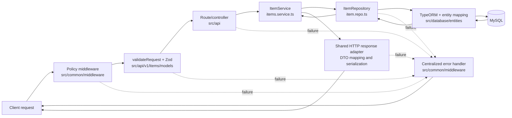

# Architecture

[Documentation index](../README.md#documentation)

## Architecture and execution paths

### Source layout

```text
src/
├── index.ts                         process entry point
├── api/
│   ├── app/                         root and operational endpoints
│   └── v1/items/                    item routes, controller, application service, request models, and OpenAPI definitions
├── application.ts                   lifecycle service graph
├── config/                          environment, HTTP, database, logging, metrics, docs, routes
├── common/
│   ├── exceptions/                  typed HTTP errors
│   ├── handlers/                    startup and shutdown lifecycle
│   ├── helpers/                     shared helpers
│   ├── library/                     shared response/query models
│   ├── middleware/                  request policy, telemetry, validation, and error middleware
│   ├── routes/                      final not-found handler
│   └── store/                       request context storage
└── database/
    ├── entities/
    ├── migrations/
    └── repositories/

test/
├── unit/
├── integration/
├── e2e/
└── helpers/database/                disposable-MySQL orchestration and safety guard
```

There is one HTTP process and one TypeORM `DataSource`; this is not a generated multi-service or
multi-version application. Routes currently comprise the application/operational routes and the
`/api/v1/items` resource.

### Startup path

1. Importing configuration loads `.env` through `dotenv/config`, validates the complete environment,
   and stops immediately on invalid or missing values.
2. `src/index.ts` registers the service graph with the lifecycle handler.
3. Startup initializes MySQL/TypeORM, verifies committed migration history, and then awaits the HTTP listening event.
   A database failure prevents the port from opening; a bind failure rejects startup.
   Concurrent startup calls share the pending operation.
4. If a later service fails, already initialized services are stopped in reverse order. A bootstrap
   failure is logged and shutdown sets a failing process exit code.

Startup deliberately does **not** synchronize the schema or run migrations
(`synchronize: false`, `migrationsRun: false`). Migrations are a separate operator/deployment step.
Unapplied migrations reject startup before the listener opens. Runtime database
readiness uses a shared, bounded `SELECT 1` probe through the application pool.
See the [database lifecycle](database-lifecycle.md) for acquisition ownership,
timeouts, caching, recovery, and shutdown sequencing.

### Request path

Shutdown admission runs before all routes, including static files. Express then serves the
favicon/static files. Application traffic passes through metrics,
request-context and HTTP logging, security headers and rate limiting, header sanitization/limits,
request timeouts, content-type and method policies, CORS, and the body-size/parser middleware. It is
then dispatched to application routes, `/api/v1`, or the documentation routes (`/docs`,
`/docs-json`, and `/redoc`). Disabled diagnostics/metrics groups are rejected
before their handlers execute, and documentation is mounted only when enabled.
See [operational exposure](development.md#operational-endpoint-exposure) for
environment defaults and the external access-control boundary. Unknown routes
become a typed 404.

Controllers validate inputs with Zod models and delegate item operations to `ItemService`.
The service owns lookup/not-found handling, PATCH/PUT semantics, and mutation sequencing;
the repository owns TypeORM persistence. Controllers configure DTO mapping and status
through the shared `jsonHandler`/`textHandler` HTTP adapters. Those adapters check
response availability before mapping/serialization, so controllers never repeat
`canRespond` checks or handle Express response state themselves.
Item controllers pass bound service methods directly:

```ts
router.get(
  '/:id',
  validateRequest({ params: IdParams }),
  jsonHandler(itemService.get, toItemDTO),
);
```

`jsonHandler` passes the parsed `{ params, query, body }` values to the service.
Unvalidated locations remain `null`; routes without validation receive all three
locations as `null`. Services declare only the locations they need, receive no
Express request or response, and use arrow methods so direct references retain
their repository binding. The adapter checks response availability before DTO
mapping and serialization.

Item mutation controllers opt into response preparation inside the transaction:

```ts
jsonHandler(itemService.update, toItemDTO, { transaction: true });
```

The handler opens one outer transaction, calls the service, maps/validates the DTO,
resolves its HTTP status, and prepares the JSON string before the final deadline
check and commit. It sends those prepared bytes only after commit succeeds. JSON
preparation uses plain `JSON.stringify()` once. Transactional responses do not
apply optional Express replacer, spacing, or HTML-character escaping settings. Invalid output, serialization failure, invalid status,
or a propagated business/persistence failure rolls back the entire transaction.

Service transaction wrappers remain in place. They join the outer transaction
through the shared helper, or open their own transaction for standalone calls:

```ts
public update = ({ params, body }: { params: IdRouteParams; body: UpdateItemInput }): Promise<ItemEntity> =>
  this.repo.transaction(async (manager) => {
    const { expected_version, ...changes } = body;
    const item = this.requireVersion(
      await this.repo.get_by_id_for_update(params.id, manager),
      expected_version,
    );
    return this.repo.update(item, changes, expected_version, manager);
  });
```

Every lookup and write in the workflow must receive that manager to use the same
connection and transaction. Create wraps its insert; update/replace/delete wrap
both lookup and mutation. Get/list remain ordinary reads.

Multiple service/repository wrappers on the same data source reuse the same manager
and have one outer commit. They must propagate failures and use the supplied
manager for every participating operation. Independently committed transactions,
other databases, and external side effects are outside that boundary. The wrapper
does not itself add domain concurrency or idempotency guarantees. Item mutations
explicitly lock their target row, compare the expected revision, and include the
revision in UPDATE/DELETE conditions. This supplies stale-write protection while
retaining the transaction/response lifecycle boundary. Optional keyed item mutations add
shared MySQL lock/claim/replay coordination through `jsonHandler`; its outer
transaction includes the item and exact prepared response record. The controller
supplies operation/scope metadata; business services remain unaware of keys and
request lifecycles. See [idempotency](idempotency.md) for scope and failure behavior.
A lifecycle-owned hourly cleanup service starts after MySQL, quiesces on shutdown,
and drains after HTTP but before database teardown.

Only item creation, PATCH/PUT, and the POST deletion action opt in; reads and system endpoints retain
their ordinary adapters. Do not enable handler transactions for streaming or
unbounded work. Response preparation holds database connections/locks until it
finishes. Successful preparation and commit cannot guarantee network delivery.

System controllers use the same direct-method pattern. `SystemService` collects
the root, health, readiness, information, diagnostics, and metrics results;
controllers retain DTO mapping, readiness HTTP status, and metrics content type.
Health does not probe the database, while readiness still checks lifecycle
dependencies on each request.

Expected `HttpError` values, malformed JSON, and Zod failures are mapped to JSON error responses.
Unexpected failures are logged with request context and returned as a generic 500 so internal error
details are not disclosed. The error envelope contains `status`, `message`, and `timestamp`.

Reusable price and revision schemas live in `src/common/library/models/price.model.ts`
and `version.model.ts`. Item contracts compose `PriceSchema`, `VersionSchema`, and
`VersionInputSchema` from that common library.

Item price payloads, output DTOs, and filters share `PriceSchema`: bounded
positive two-decimal numbers/plain decimal strings with no implicit rounding or
boolean/collection coercion. List queries use a unique ID tie-breaker in the same
sort direction and reject unsafe page offsets before repository dispatch. These
contracts preserve the existing decimal storage and offset pagination API; they
do not create a stable multi-request snapshot under concurrent writes.

### Design Decisions

The application keeps its boundaries explicit: `src/api/` owns transport and routing; item Zod
contracts live in `src/api/v1/items/models/` and are applied by `validateRequest`; and
`src/common/middleware/` owns cross-cutting HTTP policy and centralized error handling. Persistence
is exposed through `src/database/repositories/item.repo.ts`, while `src/database/entities/` owns the
TypeORM database mapping. Startup, shutdown, and runtime wiring remain outside the request features
in `src/application.ts`, `src/common/handlers/lifecycle.handler.ts`, and `src/config/`.



Controllers connect validated HTTP input to service operations and configure response DTO mapping.
Services orchestrate repository calls. The repository/transport separation prevents TypeORM and MySQL details from leaking
into routing code, and prevents HTTP status, envelope, and response-mapping mechanics from becoming
coupled to persistence. Lifecycle and configuration code compose these layers without assigning
request or storage responsibilities to the process bootstrap.

### `createApp` middleware ordering

The registration order in `createApp` (`src/config/http-server.config.ts`) is part of the HTTP
server's behavior, not a cosmetic grouping of middleware. Express enters middleware in registration
order and unwinds wrappers after downstream processing completes, so preserve these constraints:

1. **Static assets intentionally bypass API telemetry and policies.** After shutdown admission, the explicit favicon handler
   and public-directory middleware run first so asset requests do not consume API rate-limit budget,
   produce API metrics or logs, acquire request context, or encounter API content-type and method
   rules. Moving either static handler below those layers would change both observability data and
   the policy surface for assets; moving arbitrary application routes above the policy stack would,
   conversely, create an unprotected bypass.
2. **Telemetry wraps downstream processing.** Metrics, request context, and HTTP logging are entered
   before policies and routes so they can observe outcomes and latency from everything downstream,
   including policy rejections, controller responses, 404s, and errors. Moving them after a rejecting
   policy would make those rejected requests invisible, while putting request-context creation after
   logging could deprive logs and error reporting of correlation data.

   Metrics and HTTP logging subscribe to one request-outcome observer. It takes a
   single timing/outcome snapshot on finish or disconnect and removes its own
   request/response listeners before notifying subscribers. Aborted responses go
   to a separate counter rather than completed-response metrics. Full declared
   route templates keep series bounded and distinguish router mounts. See
   [logging and metrics](logging.md) for fields, labels, and observation boundaries.

3. **Proxy trust precedes identity capture and IP-based rate limiting.** `trust proxy` is configured
   from validated `TRUST_PROXY` addresses/CIDRs immediately after app creation, before request-context
   and logging middleware. It defaults to false. It must be set before the limiter is
   registered and handles requests because the limiter keys on `req.ip`. Reversing that dependency
   can group clients under the proxy address or derive identities from the wrong hop, weakening or
   misapplying throttling. The configured trust boundary must not be broadened casually either,
   because trusting unvalidated forwarding data can allow clients to spoof the identity used by the
   limiter. Sanitization retains Express forwarding headers only from a trusted transport peer;
   untrusted forwarding metadata is stripped. CORS preflight headers and configured allowed
   request headers survive sanitization, subject to blocked-header and proxy-trust rules.
4. **Cheap request policies reject before expensive request work.** Security headers, rate limiting,
   header sanitization and limits, timeouts, content-type enforcement, the method allowlist, and CORS
   all run before body parsing and controllers. Moving parsing or route dispatch ahead of them would
   spend CPU and memory on requests that should have been rejected and could let a route escape a
   security, abuse-prevention, protocol, or cross-origin control. Their relative order also has
   observable consequences: for example, moving the limiter before proxy trust changes its key, and
   moving timeout setup after parsing leaves body consumption outside that timeout protection.
5. **Body limits and parsing precede dispatch.** `bodyLimitMiddleware` selects and advertises the
   applicable size limit, then parses JSON before any supported route runs. Dispatching first would
   let controllers receive an unparsed body or consume payloads without the centralized limit;
   parsing before the limit would allocate work before oversized input is rejected.
6. **The not-found handler follows every supported route.** Application, versioned API, and
   documentation routes must all have a chance to match before `not_found` converts the request to a
   typed 404. Moving it upward would shadow every route registered below it.
7. **The error handler remains last.** `errorHandler` must follow routes and `not_found` so failures
   passed from any downstream policy, parser, controller, or fallback are mapped to the same safe
   response envelope. Middleware or routes placed after it would not have their failures mapped
   consistently and could leak Express's default error behavior instead.

### Shutdown path

The lifecycle handler installs one-shot `SIGINT` and `SIGTERM` handlers and fatal handlers for
uncaught exceptions and unhandled rejections. Shutdown immediately makes readiness false, closes
initialized services in reverse startup order (HTTP listener first, then TypeORM), waits for the
listener to drain, and preserves a nonzero exit code for fatal or cleanup failures. Repeated shutdown
requests share the pending cleanup. HTTP drain is bounded separately from the overall
shutdown watchdog; see [deadline settings](development.md#http-deadlines-and-shutdown-configuration).
HTTP readiness checks the actual listening state. Shutdown quiesces services
synchronously before awaiting pending startup or reverse cleanup, so late startup
cannot restore readiness or admit new work.

JSON/text controllers use shared response adapters backed by `trackHandler` to
retain promises beyond response completion or disconnect. Lifecycle owns a
`RequestContext` per admitted request and carries it through asynchronous work
using `AsyncLocalStorage`. The timeout middleware sets its absolute deadline;
timeout/disconnect marks it abandoned. Services receive no lifecycle object and
contain no deadline checks. The adapter skips late DTO mapping and response writes.

`runInTransaction` checks the ambient request before acquisition, after acquisition,
and after the entire callback settles, immediately before TypeORM commits. Expiry
or a business error rejects the callback so TypeORM rolls back and releases the
connection. Running SQL is never interrupted or released early. Nested application
transactions reuse the active manager from the same data source; unmanaged active
transactions are rejected. Non-HTTP callers have no HTTP deadline and still receive
normal transaction commit/rollback behavior. Expected request abandonment is not
logged as a late application failure; genuine late failures remain observed/logged.
A disconnect/expiry racing the final check or an already-started COMMIT can still
leave a committed mutation without a successful response. External side effects
are not undone by database rollback; keep them outside this guarantee.
Already accepted work remains tracked through transaction cleanup.
New routes must await their work; detached tasks are outside the drain contract.
Use the lower-level `trackHandler` only for custom transport handling, such as
streaming, where the handler must own its response semantics. A response deadline
does not cancel an already-running database operation. Database cleanup begins
after handler work settles, or after a failed finite HTTP drain. A failed drain
keeps exit status nonzero and retains the overall watchdog for live stuck work.
The production smoke check exercises real container SIGTERM; focused process and
MySQL tests exercise accepted work and deadline failures.
