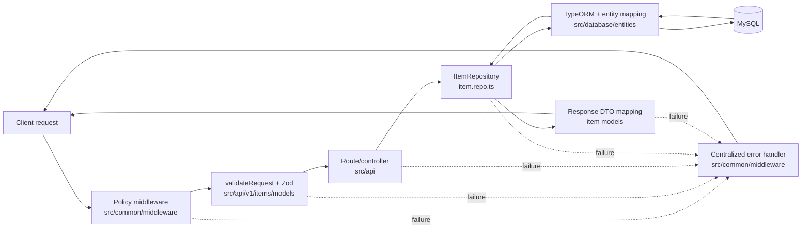

# Architecture

[Documentation index](../README.md#documentation)

## Architecture and execution paths

### Source layout

```text
src/
├── index.ts                         process entry point
├── api/
│   ├── app/                         root and operational endpoints
│   └── v1/items/                    item routes, controller, request models, and OpenAPI definitions
├── application.ts                   lifecycle service graph
├── config/                          environment, HTTP, database, logging, metrics, docs, routes
├── common/
│   ├── exceptions/                  typed HTTP errors
│   ├── handlers/                    startup and shutdown lifecycle
│   ├── helpers/                     shared helpers
│   ├── library/                     shared response/query models
│   ├── middleware/                  request policy, telemetry, validation, and error middleware
│   ├── routes/                      final not-found handler
│   └── store/                       request context storage
└── database/
    ├── entities/
    ├── migrations/
    └── repositories/

test/
├── unit/
├── integration/
├── e2e/
└── helpers/database/                disposable-MySQL orchestration and safety guard
```

There is one HTTP process and one TypeORM `DataSource`; this is not a generated multi-service or
multi-version application. Routes currently comprise the application/operational routes and the
`/api/v1/items` resource.

### Startup path

1. Importing configuration loads `.env` through `dotenv/config`, validates the complete environment,
   and stops immediately on invalid or missing values.
2. `src/index.ts` registers the service graph with the lifecycle handler.
3. Startup initializes MySQL/TypeORM first and then creates the Express listener. A database failure
   therefore prevents the HTTP port from opening.
4. If a later service fails, already initialized services are stopped in reverse order. A bootstrap
   failure is logged and shutdown sets a failing process exit code.

Startup deliberately does **not** synchronize the schema or run migrations
(`synchronize: false`, `migrationsRun: false`). Migrations are a separate operator/deployment step.

### Request path

Express serves the favicon/static files first. Application traffic then passes through metrics,
request-context and HTTP logging, security headers and rate limiting, header sanitization/limits,
request timeouts, content-type and method policies, CORS, and the body-size/parser middleware. It is
then dispatched to application routes, `/api/v1`, or the documentation routes (`/docs`,
`/docs-json`, and `/redoc`). Unknown routes become a typed 404.

Controllers validate inputs with Zod models and call the domain repository, which uses TypeORM.
Expected `HttpError` values, malformed JSON, and Zod failures are mapped to JSON error responses.
Unexpected failures are logged with request context and returned as a generic 500 so internal error
details are not disclosed. The error envelope contains `status`, `message`, and `timestamp`.

### Design Decisions

The application keeps its boundaries explicit: `src/api/` owns transport and routing; item Zod
contracts live in `src/api/v1/items/models/` and are applied by `validateRequest`; and
`src/common/middleware/` owns cross-cutting HTTP policy and centralized error handling. Persistence
is exposed through `src/database/repositories/item.repo.ts`, while `src/database/entities/` owns the
TypeORM database mapping. Startup, shutdown, and runtime wiring remain outside the request features
in `src/application.ts`, `src/common/handlers/lifecycle.handler.ts`, and `src/config/`.



Controllers translate validated HTTP input into repository calls and map returned entities into
response DTOs. The repository/transport separation prevents TypeORM and MySQL details from leaking
into routing code, and prevents HTTP status, envelope, and response-mapping mechanics from becoming
coupled to persistence. Lifecycle and configuration code compose these layers without assigning
request or storage responsibilities to the process bootstrap.

### `createApp` middleware ordering

The registration order in `createApp` (`src/config/http-server.config.ts`) is part of the HTTP
server's behavior, not a cosmetic grouping of middleware. Express enters middleware in registration
order and unwinds wrappers after downstream processing completes, so preserve these constraints:

1. **Static assets intentionally bypass API telemetry and policies.** The explicit favicon handler
   and public-directory middleware run first so asset requests do not consume API rate-limit budget,
   produce API metrics or logs, acquire request context, or encounter API content-type and method
   rules. Moving either static handler below those layers would change both observability data and
   the policy surface for assets; moving arbitrary application routes above the policy stack would,
   conversely, create an unprotected bypass.
2. **Telemetry wraps downstream processing.** Metrics, request context, and HTTP logging are entered
   before policies and routes so they can observe outcomes and latency from everything downstream,
   including policy rejections, controller responses, 404s, and errors. Moving them after a rejecting
   policy would make those rejected requests invisible, while putting request-context creation after
   logging could deprive logs and error reporting of correlation data.
3. **Proxy trust precedes identity capture and IP-based rate limiting.** `trust proxy` is configured
   from validated `TRUST_PROXY` addresses/CIDRs immediately after app creation, before request-context
   and logging middleware. It defaults to false. It must be set before the limiter is
   registered and handles requests because the limiter keys on `req.ip`. Reversing that dependency
   can group clients under the proxy address or derive identities from the wrong hop, weakening or
   misapplying throttling. The configured trust boundary must not be broadened casually either,
   because trusting unvalidated forwarding data can allow clients to spoof the identity used by the
   limiter. Sanitization retains Express forwarding headers only from a trusted transport peer;
   untrusted forwarding metadata is stripped. CORS preflight headers and configured allowed
   request headers survive sanitization, subject to blocked-header and proxy-trust rules.
4. **Cheap request policies reject before expensive request work.** Security headers, rate limiting,
   header sanitization and limits, timeouts, content-type enforcement, the method allowlist, and CORS
   all run before body parsing and controllers. Moving parsing or route dispatch ahead of them would
   spend CPU and memory on requests that should have been rejected and could let a route escape a
   security, abuse-prevention, protocol, or cross-origin control. Their relative order also has
   observable consequences: for example, moving the limiter before proxy trust changes its key, and
   moving timeout setup after parsing leaves body consumption outside that timeout protection.
5. **Body limits and parsing precede dispatch.** `bodyLimitMiddleware` selects and advertises the
   applicable size limit, then parses JSON before any supported route runs. Dispatching first would
   let controllers receive an unparsed body or consume payloads without the centralized limit;
   parsing before the limit would allocate work before oversized input is rejected.
6. **The not-found handler follows every supported route.** Application, versioned API, and
   documentation routes must all have a chance to match before `not_found` converts the request to a
   typed 404. Moving it upward would shadow every route registered below it.
7. **The error handler remains last.** `errorHandler` must follow routes and `not_found` so failures
   passed from any downstream policy, parser, controller, or fallback are mapped to the same safe
   response envelope. Middleware or routes placed after it would not have their failures mapped
   consistently and could leak Express's default error behavior instead.

### Shutdown path

The lifecycle handler installs one-shot `SIGINT` and `SIGTERM` handlers and fatal handlers for
uncaught exceptions and unhandled rejections. Shutdown immediately makes readiness false, closes
initialized services in reverse startup order (HTTP listener first, then TypeORM), waits for the
listener to drain, and preserves a nonzero exit code for fatal or cleanup failures. Repeated shutdown
requests are ignored. This is the path exercised by the production SIGTERM smoke check.
