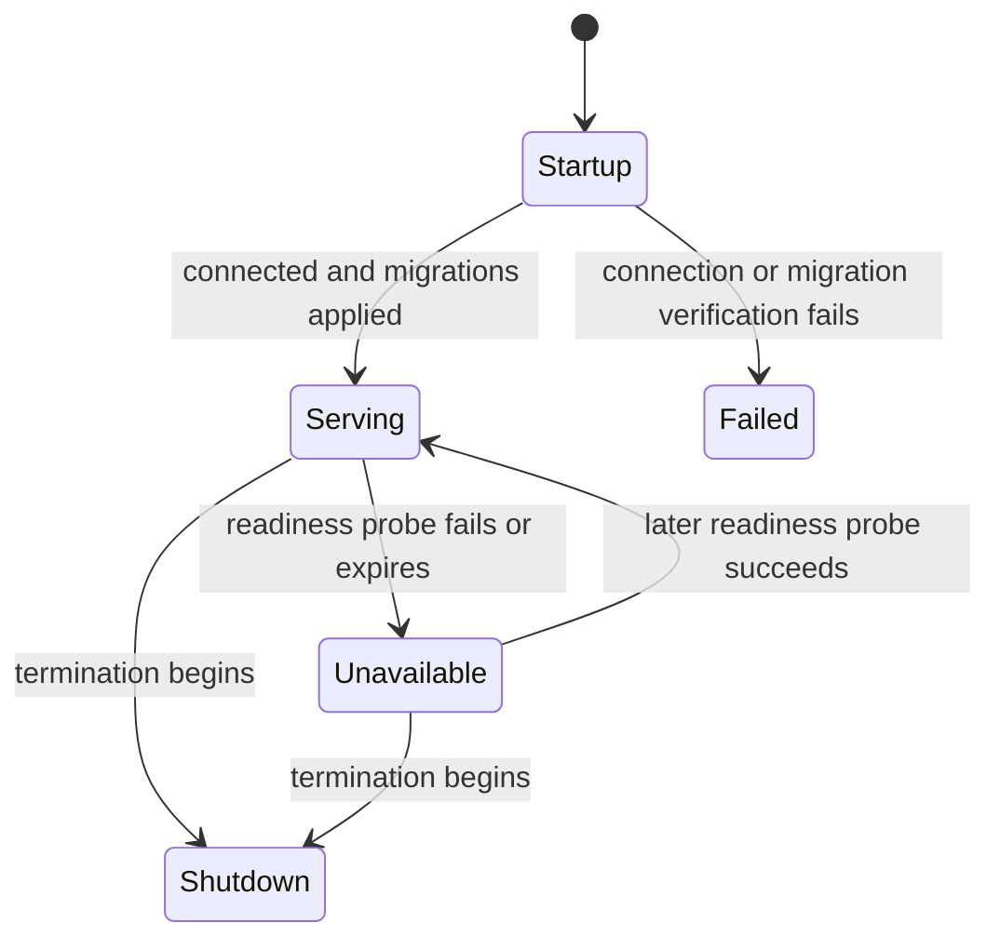

# Database readiness and recovery

[Documentation index](../README.md#documentation)

## Contract

Startup verifies that MySQL connects and all committed migrations have been applied.
After successful startup, `/ready` tests runtime connectivity through the same pool
used by item operations. `/health` reports process liveness without consulting MySQL.
Readiness checks run on demand: there is no background database monitor or retry loop.

The public `/ready` response contains only `ready`, `status`, and `timestamp`.
Dependency names and timings remain internal; probes and recovery still operate
when documentation, metrics, or diagnostics endpoints are disabled.
The detailed `/system` endpoint retains its existing database initialization
indicator; `/ready` is the endpoint that actively verifies connectivity.

## Startup

1. Validate configuration, initialize the TypeORM data source, and acquire a query
   runner for migration verification.
2. Read migration history and compare it with the migrations shipped in the application.
   Missing history is treated as unapplied migrations. The check does not create a
   migration table, apply migrations, or synchronize the schema.
3. Release the verification runner. Only successful verification permits HTTP startup.
4. On missing migrations, verification failure, or verification deadline expiry,
   clean up the database and reject startup. Bootstrap exits with status 1, and
   the HTTP listener never opens. Run the deployment migration command, then start
   the API again. An unavailable database at initial startup also requires a new start.

The migration deadline covers pool acquisition and migration inspection after
TypeORM initialization; it is not an overall initialization deadline. Initial
connection setup now uses the [explicit connection deadline](database-settings.md).
Later ORM metadata queries retain their existing behavior. Migration
history verification does not detect arbitrary schema drift, missing manually
deleted tables, data correctness, or compatibility with another writer version.

## Runtime readiness

For each `/ready` request, the lifecycle handler evaluates registered dependencies:

1. A stopped or uninitialized database is immediately unavailable.
2. If a probe already owns a runner or awaits a pool connection, callers share its
   result. No second acquisition is added, even after callers have timed out.
3. Otherwise, a still-valid cached result is reused. Both healthy and failed results
   are cached; successful results are not retained indefinitely through an outage.
4. When neither condition applies, acquire one connection from the application pool
   and execute `SELECT 1`. The readiness deadline starts before acquisition.
5. Successful SQL reports the database as `up`, releases the runner, and permits
   `/ready` to return 200 when startup and the other dependencies are also healthy.
   Failure or deadline expiry reports `down`; `/ready` returns its existing structured
   readiness body with 503. SQL errors and connection credentials are not returned.

The data source can remain initialized while connectivity is down. A later readiness
request tries again once the cache expires and prior acquisition cleanup has settled.
The pool can establish replacement connections; the application does not restart or
reinitialize the shared data source for each outage. Runtime probes do not rerun the
migration check. Schema changes still belong to deployment coordination.

## Connection ownership and deadlines

The probe owns only its query runner and acquired connection. Successful connections
are released normally. A failed or stalled active query connection is destroyed so
it cannot reenter the pool with unread results; its runner is then released. Other
requests' connections and the application pool are not destroyed by probe failure.

The application now owns a bounded acquisition queue in front of mysql2's native
pool. The readiness deadline can report `down` before the separate acquisition
deadline; that **one** acquisition remains owned until the adapter expires/removes
it or a lease arrives. Further checks share its failed result during cleanup. A
late lease is released without running SQL. New probes become eligible after
cleanup/cache expiry. Pool exhaustion cannot accumulate an unbounded probe queue.

These guarantees bound probe concurrency and readiness waiting. They do not cancel
business queries, reserve a separate connection for probes, or
provide an overall query timeout for item operations. The lifecycle handler also
has its existing five-second dependency-response cap, which may return before a
larger configured probe deadline; probe ownership still remains enforced.

## Disconnection and recovery

Deployment readiness polling discovers connectivity loss. Detection time includes
the polling interval, any remaining cache lifetime, probe deadline, and deployment
failure thresholds. A cached success may briefly return 200 after connectivity is
lost. Configure the deployment to stop routing traffic to unready instances.

During an outage, `/health` remains independent and responsive after successful
startup. Readiness does not block item routes inside Express: direct requests and
requests already accepted can still encounter database errors. The usual error
handler applies. Mutations are not automatically replayed; a lost connection during
a write can leave its outcome uncertain.

After connectivity returns, the next eligible successful probe restores readiness
without restarting the process. Recovery is observed through polling, not a push
notification. At initial startup, `/health` and `/ready` are unreachable until the
database/migration gate and listener startup have succeeded.

## Shutdown

Shutdown immediately withdraws lifecycle readiness and closes request admission.
Accepted HTTP handlers, including readiness checks, drain under the HTTP deadline.
Database teardown then stops the readiness checker, cancels its active owned query,
clears cached health, and destroys the data source. A queued late acquisition remains
marked expired and cannot start SQL or restore readiness. Shutdown does not wait
indefinitely for that queue; the existing overall shutdown watchdog remains in force.

## Configuration and operations

Pool limits, acquisition/connection deadlines, and strict TLS configuration are
documented in [Database transport and capacity](database-settings.md). They apply
to API startup/runtime and migration CLI connections.

All values are optional integer milliseconds from 1 through 2147483647; empty values
are invalid. Changes require restarting the application.

| Variable                        | Default | Purpose                                                     |
| ------------------------------- | ------- | ----------------------------------------------------------- |
| `DB_READINESS_TIMEOUT_MS`       | `1000`  | Combined readiness acquisition and query deadline.          |
| `DB_READINESS_CACHE_MS`         | `1000`  | Lifetime of a completed healthy or unhealthy result.        |
| `DB_MIGRATION_CHECK_TIMEOUT_MS` | `5000`  | Startup migration-inspection deadline after initialization. |

Apply migrations explicitly before API startup using `npm run migration:run`, or
the compiled migration CLI in the production deployment. The existing production
smoke runs this as a separate one-shot service before starting the API. Runtime
credentials must be able to read migration history and issue the required metadata
queries. Keep liveness and readiness separate in deployment checks.

## Verification boundaries

[Database readiness integration tests](../test/integration/database-readiness.test.ts)
use real disposable MySQL behind a controllable TCP proxy. They exercise dropped
connections, silently stalled traffic, replacement connections, and a fully occupied
single-connection pool through HTTP readiness requests. They verify healthy → down →
recovered on the same application, independent liveness, one queued probe under
repeated polling, server-side disappearance of retired connections, and renewed
pool usability. Startup tests verify unapplied migrations and absent history without
applying migrations or creating history tables. Unit tests cover late acquisition,
shared results, caching, deadline cleanup, and stopping an active check.

These tests establish application behavior under controlled transport faults. They
do not establish production DNS, TLS, failover, backup recovery, or orchestrator
routing behavior; those remain deployment-owned checks.
